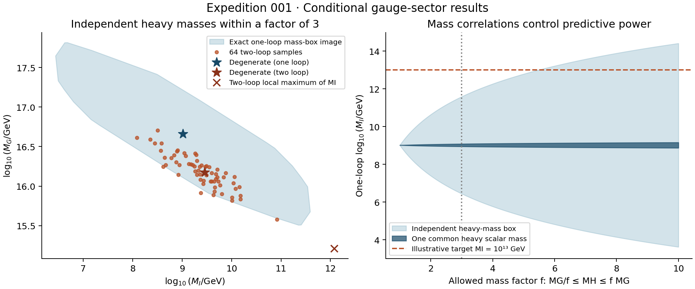

# Expedition 001 — The Great Pumpkin of 2026

Status: verification complete; draft PR handoff in preparation. Branch:
`expedition/001-great-pumpkin`. Baseline:
`8d44f8c5ca6eed3a83572471dac6f9229743ec67`. Historical scanner: its parent.
The working tree was clean at departure. No merge is authorized.

Remote `origin/main` was checked at handoff and still pointed to `b79a41f`.
The expedition branch therefore carries the pre-existing local refactor
`8d44f8c` as a prerequisite. That refactor is not credited as expedition work;
review its commit separately from the new audit/prototype commits.

## Result

**Gauge-sector convergence survives removal of the arbitrary slope and
threshold-offset controls. A physically viable unified model has not been
established.** The conditional minimal-survival SO(10) → 3221 → SM spectrum
has a unique one-loop projected solution and a stable gauge-only two-loop
solution near MI=2.84×10^9 GeV, MG=1.50×10^16 GeV. All three low-energy
gauge couplings were used to determine its three boundary unknowns; exact
agreement is an existence result, not a held-out prediction.

The most useful new result for this repository is a bound on a **family** of
mass assumptions. A weighted coupling difference eliminates the common
coupling and upper interval. For the specified 16 heavy scalars,

`|Δ log10 MI| ≤ 5.4 log10 f`, if `MG/f ≤ MH ≤ f MG` independently.

At f=3, the one-loop upper limit is log10 MI=11.59227. Thus this mass box
cannot support MI≥1e13 GeV under the stated matching assumptions. If all
heavy scalars share a common mass, the corresponding shift is only
`(21/145)log10 f`, or 0.0691 decades at f=3. The important distinction is
**independent masses versus physically correlated masses**, not numerical
precision versus a better optimizer. The proof is elementary linear algebra;
its relevant algebra and support inequality are machine-checked in Lean.

This does not establish a global two-loop exclusion or a new law of physics.
The numerical two-loop challenge finds log10 MI=12.07754 at a locally
maximal factor-three corner. It also shows why the one-loop numerical bound
must not be copied unchanged into a two-loop claim.



The shaded region is the full one-loop affine image of the factor-three
box; orange points are 64 seeded two-loop examples, not a probability sample
of physically realized vacua. The two-loop corner is a local numerical result.
The right panel displays one-loop coordinate bounds, not simultaneous bounds
on MI, MG, proton decay or vacuum stability.

## Deliverables and acceptance evidence

| Task | Outcome / acceptance check | State |
|---|---|---|
| E1 | Audit both revisions; reproduce two historical points and three current scans | verified; [audit](great-pumpkin-001-audit.md), `baselines.json` |
| E2 | Explicit spectrum, normalized matching, finite-constant comparison and bounded scalar masses | documented; [model](great-pumpkin-001-model.md) |
| E3 | Analytic and independent adaptive boundary solvers, adversarial free-offset construction | verified; [prototype](../../experiments/great_pumpkin_001/model.py), `experiments.json` |
| E4 | Methods, steps, initial guesses, data boxes, mass correlations, local adversarial optimization | verified within stated scope; numerical evidence below |
| E5 | Meaningful formal theorem without admitted proofs; independent kernel invocation | nine theorems verified; [mathematics](great-pumpkin-001-mathematics.md), `formal.json` |
| E6 | Ledger, dated literature comparison, tests and review handoff | documents/tests complete; draft PR publication pending |

Evidence files live in [`experiments/great_pumpkin_001/results`](../../experiments/great_pumpkin_001/results).
Established statements and open questions are separated in the
[research ledger](great-pumpkin-001-ledger.md). No human acceptance is implied.

## Initial evidence and scope correction

The mission describes the pre-refactor scanner. The actual baseline already
derives gauge-only two-loop LR coefficients from representations. The removed
`auto_tune_fast.py` and `spectrum_balanced_v8.json` remain available through
Git history. Both implementations will be examined, without attributing
retired defects to current code. The current code still clamps an out-of-range
crossing to a bracket boundary. Its parity discussion is internally
inconsistent: symmetric spectra have redundant equality conditions.

The current baseline's coefficient matrix agrees with published work, while
the pre-refactor LR matrix really was a zero placeholder. The archived points
reproduce exactly, but their raw R−BL inverse-coupling differences are 11.46
and 18.11. Changing the split ratio to 2 leaves the old projected residual
unchanged. This is a concrete reason those historical minima do not establish
four-coupling unification, beyond the general objection that parameters were
fitted. Historical reports remain intact.

The expedition fixes the still-present clamped-root behavior and unchecked
split convergence. The test fixture now works from either working directory,
and `validate.sh` actually asserts numerical reference agreement. Corrected
scans retain all three reference minima at their published rounding precision.

## Comparison: fitting, conditional solving, physical prediction

| Case | Freedom / assumptions | Result | Interpretation |
|---|---|---|---|
| Retired winner A | Arbitrary LR slopes, split and projected threshold vectors | residual 0.057736%; raw R−BL gap 11.46 | Fitted projected agreement, not four-gauge unification |
| Retired winner B | Same class of arbitrary controls | residual 0.051213%; raw R−BL gap 18.11 | Same identifiability failure |
| Constrained central EFT, one loop | Explicit light fields; heavy logs zero; solve MI,MG,U | log10 MI=9.01582, log10 MG=16.66062, U=46.17870 | Unique conditional projected solution |
| Constrained central EFT, gauge two loop | Same mass hypotheses; no fitted slopes/shifts | 9.45381, 16.17709, U=45.34948 | Conditional four-gauge boundary solution |
| Deliberately flexible adversary | Three unbounded inverse-coupling offsets | Exact solutions at arbitrary chosen (MI,MG,U), including (1e5,1e15,40), (1e10,1e16,45), (1e13,1e17,50) | Exact residual can be manufactured algebraically |
| Symmetric parity diagnostic | Add ΔL; symmetry preserves L=R | 10.49401, 15.35823, U=43.24204 | Equality is redundant; low MG invites a real decay calculation |

The central model is linked to 45H+126H+10C, but a stable scalar vacuum,
appropriate light Higgs direction and realistic fermion sector were not
constructed. This matters: [Jarkovská et al. (2023)](https://arxiv.org/pdf/2304.14227)
report a perturbative light-Higgs obstruction. [Preda et al. (2025)](https://arxiv.org/pdf/2502.21180)
discuss this challenge and alternative spectra; their discussion does not
license ignoring it. The prototype is a defensible conditional gauge-sector
investigation, not certification of the proposed UV completion.

## Quantitative challenges

| Challenge | Observed effect / conclusion |
|---|---|
| RK4 steps 100,200,400,800,1600; fixed MI | log10 MG changes by about 2.25e-8 from 100 to 1600; no evidence that numerical integration creates the central solution |
| Inverse-coupling DOP853 vs RK45, tighter tolerance, forward Brent roots | Scale differences below 3e-9 decades locally; independent formulations agree |
| Three alternative solver initial guesses | Same central boundary solution to numerical tolerance; no global uniqueness claimed at two loops |
| One loop → gauge two loop | Δlog10 MI≈+0.4380, Δlog10 MG≈−0.4835; theoretical truncation matters far more than step size |
| Include specified finite matching constants only | MI=10^9.47522, MG=10^16.19576; shifts +0.0214,+0.0187 decades, without claiming complete thresholds |
| PDG November-2025 central inputs | MI=10^9.47362, MG=10^16.15553 |
| Eight corners of independent PDG-sized input box | log10 MI=[9.41366,9.53429], log10 MG=[16.10954,16.20090]; sensitivity ranges, not joint confidence intervals |
| Independent factor-three GUT scalar box, one loop | Exact log10 MI range [6.43936,11.59227]; coordinate MG range [15.50566,17.81559] |
| 64 factor-three samples, gauge two loop | All accepted; sampled MI range [8.08668,10.92097], MG range [15.57996,16.70366]; not extremal/global ranges |
| Attempt to increase MI from the sign-aligned corner | Local bounded optimizer remains at log10 MI=12.07754, MG=15.21297; no certified global two-loop maximum |
| Relax mass range to reach MI≥1e13, one loop | Minimum independent mass factor ≈5.46779; linear-program solution MG=10^15.13581. Same masses at two loops give (13.51528,14.68674) |
| Enforce a common scalar mass instead | Factor-three MI shift only ±0.06910 decades at one loop, about ±0.07016 at gauge two loop |

The mass-box result is the wildcard outcome: a support inequality can eliminate
entire regions without randomly scanning them. Its physical strength depends
on the allowed mass domain. Bringing a multiplet far below MG changes the
light spectrum and invalidates this particular bound; the literature already
studies such possibilities. No general no-go result is asserted.

## Observables and evidence not used for solving

The central toy proton lifetime is 1.68×10^36 years if MX=MG and the legacy
normalization is used. The established e+π0 partial-lifetime bound is
2.4×10^34 years at 90% CL ([Super-Kamiokande, 2020](https://arxiv.org/abs/2010.16098);
also quoted by the collaboration in 2025). Merely reducing MX/MG to 0.346
would bring the same dimensional ansatz to that limit. Unknown operator
coefficients, flavour and hadronic normalization prevent claiming safety or
exclusion from this exercise. The parity diagnostic's low toy lifetime is a
warning to calculate the decay rate, not an observational no-go theorem.

For the separate illustration MR=MI and one-generation type-I seesaw,
y=0.1 gives about 106.5 eV at the central solution. Achieving the illustrative
0.05 eV target requires y≈0.00217. That Yukawa is a choice, not a prediction;
matrix cancellations, Majorana Yukawas and type-II terms are not modeled.
Consequently **no prediction was validated against held-out experimental data**.
The experimental limits serve as motivation and conditional checks only.

The relevant behavior is already well represented in published SO(10)
research. [The source comparison](great-pumpkin-001-sources.md) distinguishes
what was replicated, what differs, and why known mathematics is not claimed
as novel. No cosmological mass-sum assumption is used as a universal neutrino
constraint here.

## Reproduce and review

Use Python 3.11+; the recorded environment is Python 3.13.5, NumPy 2.1.1,
SciPy 1.16.2, pytest 8.3.3, Matplotlib 3.10.6. Install the pinned expedition
requirements in a virtual environment. From repository root:

```text
python -m pip install -r experiments/great_pumpkin_001/requirements.txt
python experiments/great_pumpkin_001/verify.py
python experiments/great_pumpkin_001/audit_baselines.py
python experiments/great_pumpkin_001/run.py
python experiments/great_pumpkin_001/plot.py
```

Full verification requires Bash (Git Bash on Windows); `verify.py --quick`
runs the 15 Python tests and checks both direct-test working directories.
The real Bash validation runs from repository root and checks all three full
reference scans. Historical reproduction needs Git history containing the
baseline and its parent. Scripts locate inputs relative to their own files.
For Lean, follow [the pinned project instructions](../../formal/great_pumpkin/README.md).

Review sequence:

1. Read the audit A4/A5 counterexamples; confirm the archived outputs are
   untouched and the root regression rejects a false bracket endpoint.
2. Inspect the field and mass assumptions, then regenerate the experiments.
   Check the analytic/DOP853 agreement before interpreting any physical scale.
3. Read the invariant and support bound; run the Lean fresh-kernel check.
   Keep the mathematical theorem separate from the physical and numerical bridge.
4. Compare the mass-correlation plot to the published scalar-potential
   challenges, then review the ledger's negative results and open questions.

The initial sandbox run of Git Bash could not create its output directory;
the authorized retry outside the sandbox completed. This was an environment
permission issue, not a suppressed failed physics check. No merge into main.

## What did we actually learn?

- **New to this repository:** its old residual hides an exactly unidentifiable
  split direction; current fixed-spectrum roots reproduce independently;
  explicit mass-domain bounds can replace parts of the scan.
- **What remains possible:** the gauge-sector solutions may intersect a
  physically realizable correlated spectrum, or a different light spectrum
  may evade the conditional obstruction. Neither has been shown here.
- **What we ruled out:** interpreting the historical residual as four-coupling
  unification; treating parity as automatically independent; MI≥1e13 GeV
  in the stated one-loop factor-three scalar box. We did not rule out SO(10).
- **Single next question:** does a stable, perturbative scalar vacuum with a
  viable light Higgs/fermion sector intersect the gauge-compatible threshold
  region once its mass correlations are imposed?
- **Did anything survive removal of arbitrary fitting freedom?** Yes: a
  conditional gauge-sector solution and a useful family-wide one-loop bound.
  Neither establishes grand unification in nature.
